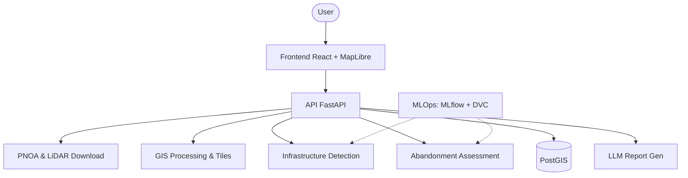
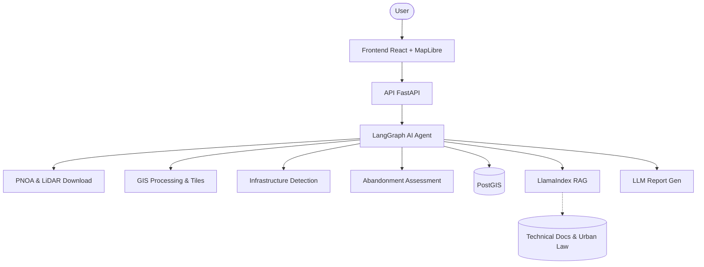

# System Architecture

> High-level architecture of the system. Updated whenever architectural changes are made.

## Overview

The system is a pipeline exposed through a web platform. Given a bounding box, it
downloads PNOA orthophotos and LiDAR point clouds, prepares and tiles them,
detects infrastructure, extracts indicators for each detection and combines them
into an abandonment index, which the platform shows on a map and summarises in a
generated report.

Four layers, kept independent so that business logic never depends on delivery:

| Layer | Responsibility |
|---|---|
| **Domain** | Abandonment indicators and index, detection and tile entities, data contracts. No I/O. |
| **Data** | PNOA and LiDAR acquisition, GIS processing, tiling, PostGIS persistence. |
| **Application** | Detection, indicator extraction, assessment and report generation, orchestrating domain and data. |
| **Delivery** | FastAPI, the React + MapLibre frontend and the CLI. Interchangeable. |

Each layer is a top-level package under `src/` (`geo_decay_domain`,
`geo_decay_data`, `geo_decay_application`, `geo_decay_delivery`). Ports are
defined in the domain; the application uses them and the data layer implements
them, so application and data never import each other. Delivery is the
composition root. import-linter enforces these rules in the quality gate
([ADR-003](adr/adr-003-src-layout-and-layer-boundaries.md)).

MLflow and DVC sit alongside the pipeline rather than inside it: they record
experiments and version data and artefacts without the pipeline depending on
them. The build order of these layers is the block order in
[roadmap.md](../roadmap.md): infrastructure, then MLOps, then the GIS core, then
detection, assessment, experimentation and the platform.

## Component Diagram

### MVP (v1.0) Architecture

### Extended Version (v2.0) Architecture

## Data Flow

1. **Request.** A bounding box arrives from the frontend or the CLI.
2. **Acquisition.** Orthophotos and LiDAR tiles are downloaded for that extent
   and versioned on arrival, so every later result traces back to a known input.
3. **Preparation.** Rasters and point clouds are processed into analysis-ready
   data, and the area is split into fixed-size tiles for parallel work.
4. **Detection.** Each tile is run through the selected detection methodology,
   and every detection becomes an independent geospatial entity in PostGIS.
5. **Assessment.** For each entity, indicators are extracted — vegetation, roof
   condition, debris, accessibility, temporal change and LiDAR-derived features —
   and combined into an explainable abandonment index.
6. **Delivery.** Entities and indices are served through the API, shown on the
   map and summarised in generated reports.

Heavy data never travels through an agent's context: it is written to disk,
versioned, and inspected through scripts whose output is read instead.

## Key Design Decisions

Recorded:

- [ADR-001](adr/adr-001-agent-governance.md) — agent governance model: roles,
  tiers, security layers.
- [ADR-002](adr/adr-002-operational-roadmap.md) — operational roadmap and the
  composition of Block 1.
- [ADR-003](adr/adr-003-src-layout-and-layer-boundaries.md) — `src/` layout and
  the enforced boundaries between the four layers above.
- [ADR-005](adr/adr-005-dependency-and-environment-manager.md) — uv, Python
  3.12 and the quality-gate tooling.

Pending:

- **ADR-004** — coordinate reference system, tile size and the data contracts
  between pipeline stages. The decision most expensive to change later;
  required before the GIS core (Block 3).

## Deployment Architecture

Development and execution both run in containers, so the C-level GIS dependencies
(GDAL, PDAL, Rasterio) are identical everywhere:

- A **DevContainer** provides the development environment, with GDAL and PDAL
  installed at system level.
- **Docker Compose** composes the application image with PostgreSQL/PostGIS and
  the MLflow tracking server.
- **CI** builds the same image and runs lint, formatting, type checks and tests
  against it (Sprint 3).

Secrets are supplied through the environment and never committed; `.env.example`
holds key names and placeholders only.

## Related Documents

- [Technology Stack](stack.md)
- [ADR Index](adr/README.md)
- [Project Context](../project_context.md)
